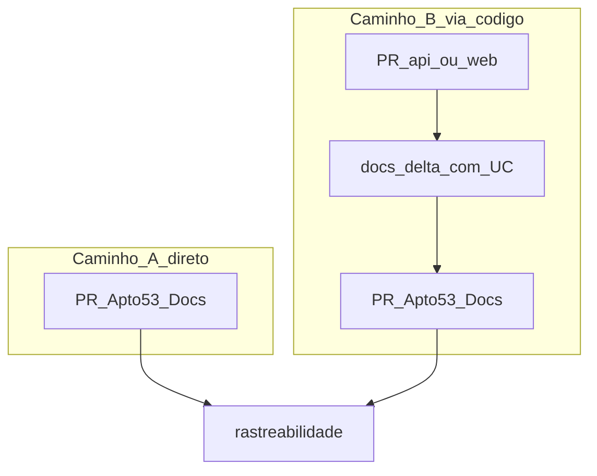

## [DCR-01] Processo de pull request do Apto 53 (docs e código)

Neste documento:

1.  [Contexto](#contexto)
2.  [Opções](#opções)
3.  [Decisão](#decisão)
4.  [Consequências](#consequências)
5.  [Referências](#referências)
6.  [Versões](#versões)
7.  [Revisões](#revisões)

### Contexto

Com a documentação centralizada em **Apto53-Docs** ([ADR-02](../ADR/ADR-02-repositorio-docs-fonte-verdade.md)) e o código em repos separados, é preciso um processo claro de Pull Request que:

- permita **atualizar a documentação diretamente** neste repositório;
- permita mudanças de comportamento na api/web **rastreáveis** por `UC##` / `RNF##`;
- não obrigue, no MVP, a existência do automation bridge (dois PRs manuais são aceitáveis).

Sem esse processo, a matriz de rastreabilidade deixa de refletir o que foi entregue e os requisitos divergem do código.

### Opções

Foram consideradas as seguintes opções:

* **Somente monorepo / um PR único:** código e docs sempre no mesmo PR.
    * **Prós:** um único merge.
    * **Contras:** incompatível com a decisão ADR-02 de repos separados.
* **Somente automation bridge:** todo PR de código gera automaticamente um PR em Apto53-Docs.
    * **Prós:** menos atrito operacional.
    * **Contras:** ainda não implementado; não cobre bem “só docs” (requisito antes do código).
* **Dois caminhos oficiais — atualização direta nos docs e via código + docs-delta (bridge opcional no futuro):**
    * **Prós:** cobre docs-only e código+docs; MVP simples; bridge pode entrar depois sem mudar o modelo mental.
    * **Contras:** disciplina humana para declarar IDs e atualizar a matriz.

### Decisão

Adotar o seguinte **processo de Pull Request** para o Apto 53.

#### Caminho A — Atualização direta em Apto53-Docs

Usar quando a mudança é só documentação, ou quando os requisitos/ADR/contexto mudam **antes** ou **sem** alteração de código.

1. Abrir branch e PR **somente** em `Apto53-Docs`.
2. Atualizar ERS e/ou rastreabilidade e/ou contexto e/ou ADR/DCR conforme os [acordos](../../../.cursor/rules/acordos-documentacao.mdc).
3. Manter IDs estáveis; se criar UC/RNF novo, incluir na matriz.
4. Revisar e mergear o PR de docs.

#### Caminho B — Mudança via código (api/web) + docs

Usar quando o comportamento do sistema muda no código.

1. Abrir PR em `Apto53-api` e/ou `Apto53-web`.
2. Declarar **docs-delta** no PR (IDs obrigatórios), por exemplo:

```markdown
## docs-delta
- requisitos: UC09, RNF08
- impacto: api
- resumo: from-url aceita iptu ausente
- arquivos-docs: DOCS/rastreabilidade_requisitos.md, DOCS/especificacao_requisitos_software.md
```

3. Atualizar `Apto53-Docs` no mesmo pacote de trabalho:
   - **MVP:** abrir/atualizar PR manual neste repo com as mudanças de ERS/matriz/ADR; **ou**
   - **Futuro:** automation bridge cria/atualiza o PR em Apto53-Docs a partir do delta.
4. No repo de código (`Apto53-api`), atualizar o **contexto vivo** `contexto_modulos.md` (paths/contratos) — não copiar esse mapa para o Docs.
5. Preencher/ajustar a linha do requisito na matriz (colunas API e/ou Web).
6. Não considerar a entrega completa enquanto a rastreabilidade do ID citado estiver incoerente.

#### Regras comuns

- Comportamento novo ou alterado exige pelo menos um `UC##` ou `RNF##` (existente ou criado no mesmo pacote de docs).
- Apto53-api / Apto53-web **não** copiam a ERS; contexto de implementação da api mora em `Apto53-api/contexto_modulos.md`.
- O bridge **não** é obrigatório no MVP; atualização direta (caminho A) e PR manual de docs no caminho B são oficiais.



**Data:** 05/10/2026

### Consequências

#### Benefícios

* Docs podem evoluir sem esperar código (caminho A).
* Toda mudança de código fica amarrada a IDs e à matriz (caminho B).
* Bridge futuro encaixa sem redesenhar o processo.

#### Malefícios

* No MVP, caminho B pode exigir dois PRs manuais.
* Exige que o autor declare o delta corretamente.

#### Riscos

* Merge de código sem docs — mitigar com checklist de PR e revisão; no futuro, policy de release/CI.
* IDs errados no delta — mitigar consultando a matriz/ERS em Apto53-Docs antes do PR.

### Referências

* [ADR-02 — Apto53-Docs como fonte da verdade](../ADR/ADR-02-repositorio-docs-fonte-verdade.md)
* [Acordos de documentação](../../../.cursor/rules/acordos-documentacao.mdc)
* [Rastreabilidade de requisitos](../../rastreabilidade_requisitos.md)
* Template do diário: [templates/diario-decisoes.md](../../../templates/diario-decisoes.md)

### Versões

| Versão | Data | Descrição | Responsável |
| :---- | :---- | :---- | :---- |
| 1.0 | 05/10/2026 | Versão inicial | Cauê Moraes |

### Revisões

| Data | Responsável |
| :---- | :---- |
| 05/10/2026 | Cauê Moraes |
