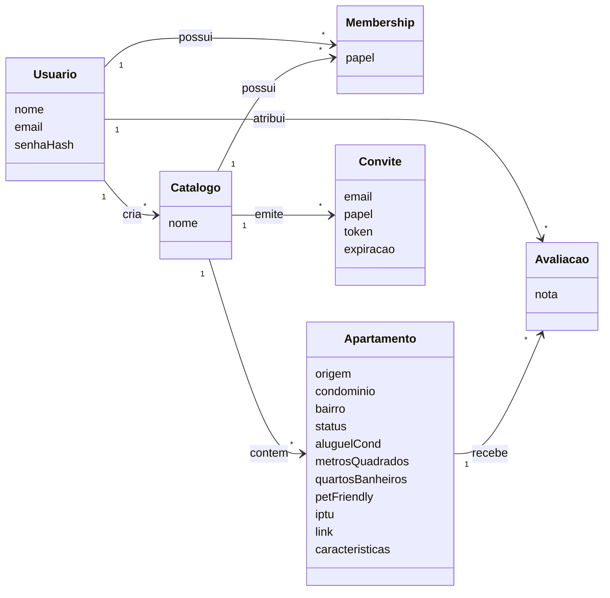
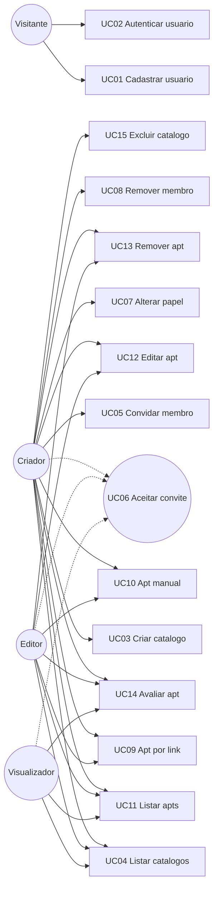

## Especificação de Requisitos de Software

### 1. Introdução

Este documento registra os requisitos detalhados do Sistema **Apto 53** (Catálogos de Apartamentos para Aluguel), na forma de **descrição de casos de uso** do produto. A documentação canônica vive no repositório **Apto53-Docs**.

O sistema permite que usuários autenticados criem e compartilhem **catálogos** de apartamentos para alugar, com controle de acesso por papéis (**criador**, **editor** e **visualizador**). Apartamentos podem ser adicionados **manualmente** ou **a partir do link** de anúncios em portais imobiliários (QuintoAndar, Chaves na Mão, Imovelweb, Viva Real e Zap Imóveis), com posterior edição, avaliação individual e cálculo de nota média.

A rastreabilidade entre estes requisitos e demais artefatos está definida em [rastreabilidade_requisitos.md](./rastreabilidade_requisitos.md).

### 2. Classes de usuários

#### 2.1. Visitante

Usuário não autenticado. Pode criar conta e autenticar-se no sistema. Não possui acesso a catálogos nem a apartamentos.

#### 2.2. Criador

Usuário autenticado que criou um determinado catálogo e é o único dono desse catálogo. Pode gerenciar membros (convidar, alterar papéis entre editor e visualizador, remover), gerenciar apartamentos (adicionar por link ou manualmente, editar, remover), avaliar apartamentos e excluir o catálogo. Um mesmo usuário pode ser criador de um catálogo e editor ou visualizador de outros.

#### 2.3. Editor

Membro autenticado de um catálogo com permissão de escrita sobre apartamentos. Pode adicionar apartamentos (por link ou manualmente), editar e remover apartamentos, listar dados e registrar a própria nota. Não pode convidar, remover ou alterar papéis de membros.

#### 2.4. Visualizador

Membro autenticado de um catálogo com permissão apenas de leitura dos apartamentos e de seus dados, podendo registrar a própria nota. Não pode adicionar, editar ou remover apartamentos, nem gerenciar membros.

### 3. Definição de conceitos

#### 3.1. Glossário

**Usuário** - Pessoa cadastrada no sistema, identificada por nome, e-mail único e senha armazenada de forma segura (hash).

**Catálogo** - Conjunto de apartamentos com restrição de acesso. Possui um único criador (dono) e zero ou mais membros com papéis de editor ou visualizador.

**Membro** - Usuário associado a um catálogo mediante membership, com um papel (criador, editor ou visualizador).

**Papel** - Permissão do membro no catálogo: criador, editor ou visualizador.

**Convite** - Solicitação enviada pelo criador para um e-mail, atribuindo papel de editor ou visualizador, com token e prazo de validade, até aceitação ou expiração.

**Apartamento** - Registro de um imóvel de interesse para aluguel, pertencente a um catálogo, com atributos de negócio (condomínio, bairro, status, aluguel+condomínio, metros², quartos/banheiros, pet friendly, IPTU, link, características) e origem (`link` ou `manual`).

**Origem (source)** - Indica se o apartamento foi importado a partir de um link de anúncio (`link`) ou cadastrado manualmente (`manual`).

**Características** - Lista de atributos e diferenciais do imóvel (por exemplo: armários de cozinha, varanda, sol da manhã).

**Avaliação (nota)** - Pontuação individual atribuída por um membro a um apartamento do catálogo do qual participa.

**Nota média** - Média aritmética das notas atribuídas ao apartamento pelos membros que o avaliaram.

**Portal imobiliário** - Site externo de anúncios suportado para importação por link (QuintoAndar, Chaves na Mão, Imovelweb, Viva Real, Zap Imóveis).

#### 3.2. Modelo conceitual

- **Usuario**: pessoa autenticável no sistema.
- **Catalogo**: coleção controlada de apartamentos.
- **Membership**: vínculo usuário–catálogo com papel.
- **Convite**: pendência de entrada no catálogo.
- **Apartamento**: imóvel catalogado.
- **Avaliacao**: nota de um membro a um apartamento.

### 4. Requisitos de Software

Nesta seção são descritos os casos de uso do produto. Na Seção 4.1 são descritos os requisitos funcionais (casos de uso). Na Seção 4.2 são descritos os requisitos não-funcionais.

#### 4.1. Requisitos funcionais

##### 4.1.1. Diagrama de casos de uso

Os atores **Criador**, **Editor** e **Visualizador** pressupõem usuário já autenticado (pós-condição de UC02). O papel aplica-se no contexto de um catálogo específico.

##### 4.1.2. Descrição detalhada dos casos de uso

| Dado                | Valor |
| ------------------- | ----- |
| Nome do caso de uso | Cadastrar usuário |
| Identificador       | UC01 |
| Pré-condições       | O visitante não possui conta com o e-mail informado. |
| Pós-condições       | Existe um usuário cadastrado com nome, e-mail e senha armazenada de forma segura; o visitante pode autenticar-se. |
| Fluxo principal     | 1. O visitante informa nome, e-mail e senha. 2. O sistema valida os dados informados. 3. O sistema registra o usuário com a senha armazenada de forma segura. 4. O sistema confirma o cadastro. |
| Fluxos alternativos | 2 - FA01 Dados inválidos: 2.1 O sistema informa que os dados não atendem às regras de validação. 2.2 Encerra o caso de uso.  2 - FA02 E-mail já cadastrado: 2.1 O sistema informa que o e-mail já está em uso. 2.2 Encerra o caso de uso. |

_Tabela — Descrição do Caso de Uso UC01_

| Dado                | Valor |
| ------------------- | ----- |
| Nome do caso de uso | Autenticar usuário |
| Identificador       | UC02 |
| Pré-condições       | Existe um usuário cadastrado com o e-mail informado. |
| Pós-condições       | O usuário está autenticado e pode acessar funcionalidades conforme seus papéis nos catálogos. |
| Fluxo principal     | 1. O visitante informa e-mail e senha. 2. O sistema valida as credenciais. 3. O sistema estabelece a sessão autenticada do usuário. 4. O sistema confirma a autenticação. |
| Fluxos alternativos | 2 - FA01 Credenciais inválidas: 2.1 O sistema informa que e-mail ou senha estão incorretos. 2.2 Encerra o caso de uso. |

_Tabela — Descrição do Caso de Uso UC02_

| Dado                | Valor |
| ------------------- | ----- |
| Nome do caso de uso | Criar catálogo |
| Identificador       | UC03 |
| Pré-condições       | O usuário está autenticado. |
| Pós-condições       | Existe um novo catálogo cujo criador é o usuário autenticado; o usuário é membro com papel criador. |
| Fluxo principal     | 1. O usuário informa o nome do catálogo. 2. O sistema valida o nome. 3. O sistema cria o catálogo e associa o usuário como criador. 4. O sistema confirma a criação e disponibiliza o catálogo ao usuário. |
| Fluxos alternativos | 2 - FA01 Nome inválido: 2.1 O sistema informa que o nome é inválido. 2.2 Encerra o caso de uso. |

_Tabela — Descrição do Caso de Uso UC03_

| Dado                | Valor |
| ------------------- | ----- |
| Nome do caso de uso | Listar catálogos do usuário |
| Identificador       | UC04 |
| Pré-condições       | O usuário está autenticado. |
| Pós-condições       | O sistema apresentou os catálogos em que o usuário é membro, com o respectivo papel. |
| Fluxo principal     | 1. O usuário solicita a listagem de seus catálogos. 2. O sistema identifica os catálogos em que o usuário possui membership. 3. O sistema apresenta a lista de catálogos com o papel do usuário em cada um. |
| Fluxos alternativos | 2 - FA01 Nenhum catálogo: 2.1 O sistema informa que o usuário não participa de nenhum catálogo. 2.2 Encerra o caso de uso. |

_Tabela — Descrição do Caso de Uso UC04_

| Dado                | Valor |
| ------------------- | ----- |
| Nome do caso de uso | Convidar membro ao catálogo |
| Identificador       | UC05 |
| Pré-condições       | O usuário está autenticado e é o criador do catálogo. |
| Pós-condições       | Existe um convite pendente para o e-mail informado, com papel editor ou visualizador, token e prazo de validade. |
| Fluxo principal     | 1. O criador informa o e-mail do convidado e o papel desejado (editor ou visualizador). 2. O sistema valida o e-mail e o papel. 3. O sistema cria o convite com token e expiração. 4. O sistema disponibiliza o convite para aceitação pelo convidado. 5. O sistema confirma o envio/registro do convite. |
| Fluxos alternativos | 2 - FA01 Papel inválido: 2.1 O sistema informa que apenas editor ou visualizador podem ser convidados. 2.2 Encerra o caso de uso.  2 - FA02 E-mail já é membro: 2.1 O sistema informa que o e-mail já possui membership no catálogo. 2.2 Encerra o caso de uso.  2 - FA03 Convite duplicado pendente: 2.1 O sistema informa que já existe convite pendente para aquele e-mail neste catálogo. 2.2 Encerra o caso de uso. |

_Tabela — Descrição do Caso de Uso UC05_

| Dado                | Valor |
| ------------------- | ----- |
| Nome do caso de uso | Aceitar convite |
| Identificador       | UC06 |
| Pré-condições       | Existe um convite pendente e não expirado; o usuário está autenticado com o mesmo e-mail do convite. |
| Pós-condições       | O usuário é membro do catálogo com o papel definido no convite; o convite deixa de estar pendente. |
| Fluxo principal     | 1. O usuário apresenta o token do convite. 2. O sistema valida o token, a expiração e a correspondência do e-mail autenticado. 3. O sistema cria a membership com o papel do convite. 4. O sistema marca o convite como aceito. 5. O sistema confirma a adesão ao catálogo. |
| Fluxos alternativos | 2 - FA01 Token inválido ou expirado: 2.1 O sistema informa que o convite é inválido ou expirou. 2.2 Encerra o caso de uso.  2 - FA02 E-mail divergente: 2.1 O sistema informa que o usuário autenticado não corresponde ao e-mail convidado. 2.2 Encerra o caso de uso. |

_Tabela — Descrição do Caso de Uso UC06_

| Dado                | Valor |
| ------------------- | ----- |
| Nome do caso de uso | Alterar papel de membro |
| Identificador       | UC07 |
| Pré-condições       | O usuário está autenticado e é o criador do catálogo; o membro-alvo é editor ou visualizador do mesmo catálogo. |
| Pós-condições       | O papel do membro-alvo no catálogo foi alterado entre editor e visualizador. |
| Fluxo principal     | 1. O criador seleciona o membro e informa o novo papel (editor ou visualizador). 2. O sistema valida que o membro-alvo não é o criador e que o novo papel é permitido. 3. O sistema atualiza o papel do membro. 4. O sistema confirma a alteração. |
| Fluxos alternativos | 2 - FA01 Tentativa de alterar o criador: 2.1 O sistema informa que o papel de criador não pode ser alterado por este fluxo. 2.2 Encerra o caso de uso.  2 - FA02 Membro inexistente no catálogo: 2.1 O sistema informa que o usuário informado não é membro do catálogo. 2.2 Encerra o caso de uso. |

_Tabela — Descrição do Caso de Uso UC07_

| Dado                | Valor |
| ------------------- | ----- |
| Nome do caso de uso | Remover membro do catálogo |
| Identificador       | UC08 |
| Pré-condições       | O usuário está autenticado e é o criador do catálogo; o membro-alvo é editor ou visualizador do mesmo catálogo. |
| Pós-condições       | O membro-alvo deixa de ter acesso ao catálogo. |
| Fluxo principal     | 1. O criador solicita a remoção de um membro. 2. O sistema valida que o membro-alvo não é o criador. 3. O sistema remove a membership do membro-alvo. 4. O sistema confirma a remoção. |
| Fluxos alternativos | 2 - FA01 Tentativa de remover o criador: 2.1 O sistema informa que o criador não pode ser removido por este fluxo. 2.2 Encerra o caso de uso.  2 - FA02 Membro inexistente: 2.1 O sistema informa que o usuário não é membro do catálogo. 2.2 Encerra o caso de uso. |

_Tabela — Descrição do Caso de Uso UC08_

| Dado                | Valor |
| ------------------- | ----- |
| Nome do caso de uso | Adicionar apartamento a partir de link |
| Identificador       | UC09 |
| Pré-condições       | O usuário está autenticado e é criador ou editor do catálogo. |
| Pós-condições       | Existe um apartamento no catálogo com origem `link`, campos preenchidos a partir do anúncio quando disponíveis, e link registrado. |
| Fluxo principal     | 1. O usuário informa o link do anúncio e o catálogo de destino. 2. O sistema verifica que o usuário é criador ou editor do catálogo. 3. O sistema identifica o portal imobiliário a partir do link. 4. O sistema obtém os dados do anúncio e normaliza os atributos do apartamento (condomínio, bairro, status, aluguel+condomínio, metros², quartos/banheiros, pet friendly, IPTU, características, quando disponíveis). 5. O sistema registra o apartamento no catálogo com origem `link`. 6. O sistema apresenta o apartamento registrado. |
| Fluxos alternativos | 2 - FA01 Sem permissão: 2.1 O sistema informa que o usuário não tem permissão para adicionar apartamentos neste catálogo. 2.2 Encerra o caso de uso.  3 - FA02 Portal não suportado: 3.1 O sistema informa que o link não pertence a um portal suportado. 3.2 Encerra o caso de uso.  4 - FA03 Falha na obtenção dos dados: 4.1 O sistema informa que não foi possível obter os dados do anúncio. 4.2 Encerra o caso de uso.  4 - FA04 Dados parciais: 4.1 O sistema registra o apartamento com os campos obtidos e indica os campos não preenchidos. 4.2 Continua no passo 6 do fluxo principal. |

_Tabela — Descrição do Caso de Uso UC09_

| Dado                | Valor |
| ------------------- | ----- |
| Nome do caso de uso | Adicionar apartamento manualmente |
| Identificador       | UC10 |
| Pré-condições       | O usuário está autenticado e é criador ou editor do catálogo. |
| Pós-condições       | Existe um apartamento no catálogo com origem `manual` e com os atributos informados pelo usuário. |
| Fluxo principal     | 1. O usuário informa o catálogo de destino e os atributos do apartamento que desejar preencher (condomínio, bairro, status, aluguel+condomínio, metros², quartos/banheiros, pet friendly, IPTU, link opcional, características). 2. O sistema verifica que o usuário é criador ou editor do catálogo. 3. O sistema valida os atributos informados. 4. O sistema registra o apartamento no catálogo com origem `manual`. 5. O sistema apresenta o apartamento registrado. |
| Fluxos alternativos | 2 - FA01 Sem permissão: 2.1 O sistema informa que o usuário não tem permissão para adicionar apartamentos neste catálogo. 2.2 Encerra o caso de uso.  3 - FA02 Dados inválidos: 3.1 O sistema informa quais atributos são inválidos. 3.2 Encerra o caso de uso. |

_Tabela — Descrição do Caso de Uso UC10_

| Dado                | Valor |
| ------------------- | ----- |
| Nome do caso de uso | Listar apartamentos do catálogo |
| Identificador       | UC11 |
| Pré-condições       | O usuário está autenticado e é membro do catálogo (criador, editor ou visualizador). |
| Pós-condições       | O sistema apresentou os apartamentos do catálogo e seus dados, incluindo nota média quando houver avaliações. |
| Fluxo principal     | 1. O usuário solicita a listagem de apartamentos de um catálogo. 2. O sistema verifica que o usuário é membro do catálogo. 3. O sistema obtém os apartamentos do catálogo. 4. O sistema calcula a nota média de cada apartamento a partir das avaliações existentes. 5. O sistema apresenta os apartamentos com seus atributos e notas. |
| Fluxos alternativos | 2 - FA01 Sem permissão: 2.1 O sistema informa que o usuário não tem acesso ao catálogo. 2.2 Encerra o caso de uso.  3 - FA02 Catálogo vazio: 3.1 O sistema informa que não há apartamentos no catálogo. 3.2 Encerra o caso de uso. |

_Tabela — Descrição do Caso de Uso UC11_

| Dado                | Valor |
| ------------------- | ----- |
| Nome do caso de uso | Editar apartamento |
| Identificador       | UC12 |
| Pré-condições       | O usuário está autenticado e é criador ou editor do catálogo; o apartamento pertence a esse catálogo. |
| Pós-condições       | Os atributos do apartamento foram atualizados conforme os dados informados. |
| Fluxo principal     | 1. O usuário informa o apartamento e os atributos a atualizar. 2. O sistema verifica que o usuário é criador ou editor do catálogo do apartamento. 3. O sistema valida os novos atributos. 4. O sistema atualiza o apartamento. 5. O sistema confirma a atualização. |
| Fluxos alternativos | 2 - FA01 Sem permissão: 2.1 O sistema informa que o usuário não pode editar apartamentos neste catálogo. 2.2 Encerra o caso de uso.  2 - FA02 Apartamento inexistente: 2.1 O sistema informa que o apartamento não foi encontrado no catálogo. 2.2 Encerra o caso de uso.  3 - FA03 Dados inválidos: 3.1 O sistema informa quais atributos são inválidos. 3.2 Encerra o caso de uso. |

_Tabela — Descrição do Caso de Uso UC12_

| Dado                | Valor |
| ------------------- | ----- |
| Nome do caso de uso | Remover apartamento |
| Identificador       | UC13 |
| Pré-condições       | O usuário está autenticado e é criador ou editor do catálogo; o apartamento pertence a esse catálogo. |
| Pós-condições       | O apartamento e suas avaliações deixam de pertencer ao catálogo. |
| Fluxo principal     | 1. O usuário solicita a remoção de um apartamento do catálogo. 2. O sistema verifica que o usuário é criador ou editor do catálogo. 3. O sistema remove o apartamento e suas avaliações associadas. 4. O sistema confirma a remoção. |
| Fluxos alternativos | 2 - FA01 Sem permissão: 2.1 O sistema informa que o usuário não pode remover apartamentos neste catálogo. 2.2 Encerra o caso de uso.  2 - FA02 Apartamento inexistente: 2.1 O sistema informa que o apartamento não foi encontrado no catálogo. 2.2 Encerra o caso de uso. |

_Tabela — Descrição do Caso de Uso UC13_

| Dado                | Valor |
| ------------------- | ----- |
| Nome do caso de uso | Avaliar apartamento |
| Identificador       | UC14 |
| Pré-condições       | O usuário está autenticado e é membro do catálogo (criador, editor ou visualizador); o apartamento pertence a esse catálogo. |
| Pós-condições       | Existe a nota do usuário para o apartamento; a nota média do apartamento reflete as avaliações dos membros. |
| Fluxo principal     | 1. O usuário informa o apartamento e a respectiva nota. 2. O sistema verifica que o usuário é membro do catálogo do apartamento. 3. O sistema valida a nota. 4. O sistema registra ou atualiza a avaliação do usuário para aquele apartamento. 5. O sistema recalcula a nota média do apartamento. 6. O sistema confirma a avaliação e apresenta a nota média atualizada. |
| Fluxos alternativos | 2 - FA01 Sem permissão: 2.1 O sistema informa que o usuário não tem acesso ao catálogo. 2.2 Encerra o caso de uso.  3 - FA02 Nota inválida: 3.1 O sistema informa que a nota está fora do intervalo permitido. 3.2 Encerra o caso de uso. |

_Tabela — Descrição do Caso de Uso UC14_

| Dado                | Valor |
| ------------------- | ----- |
| Nome do caso de uso | Excluir catálogo |
| Identificador       | UC15 |
| Pré-condições       | O usuário está autenticado e é o criador do catálogo. |
| Pós-condições       | O catálogo, seus memberships, convites pendentes, apartamentos e avaliações associados deixam de existir. |
| Fluxo principal     | 1. O criador solicita a exclusão do catálogo. 2. O sistema verifica que o usuário é o criador. 3. O sistema remove apartamentos, avaliações, convites, memberships e o catálogo. 4. O sistema confirma a exclusão. |
| Fluxos alternativos | 2 - FA01 Sem permissão: 2.1 O sistema informa que apenas o criador pode excluir o catálogo. 2.2 Encerra o caso de uso. |

_Tabela — Descrição do Caso de Uso UC15_

##### 4.1.3. Matriz resumida de permissões por catálogo

| Ação | Criador | Editor | Visualizador |
| ---- | ------- | ------ | ------------ |
| Listar apartamentos e dados | Sim | Sim | Sim |
| Adicionar apartamento por link | Sim | Sim | Não |
| Adicionar apartamento manualmente | Sim | Sim | Não |
| Editar apartamento | Sim | Sim | Não |
| Remover apartamento | Sim | Sim | Não |
| Avaliar apartamento (própria nota) | Sim | Sim | Sim |
| Convidar membro (editor/visualizador) | Sim | Não | Não |
| Alterar papel de membro | Sim | Não | Não |
| Remover membro | Sim | Não | Não |
| Excluir catálogo | Sim | Não | Não |

#### 4.2. Requisitos não-funcionais

**RNF01** - O sistema deve armazenar senhas exclusivamente na forma de hash seguro (Argon2 ou bcrypt), nunca em texto puro.

**RNF02** - O sistema deve exigir autenticação válida antes de permitir acesso a catálogos, membros, convites, apartamentos e avaliações.

**RNF03** - O sistema deve autorizar cada operação de catálogo e apartamento com base no membership e no papel do usuário autenticado naquele catálogo.

**RNF04** - O sistema deve impedir que um usuário acesse ou modifique dados de um catálogo do qual não seja membro.

**RNF05** - O sistema deve associar a cada convite um token opaco e uma data de expiração.

**RNF06** - O sistema deve permitir aceitar um convite somente quando o e-mail do usuário autenticado coincidir com o e-mail do convite e o convite estiver válido.

**RNF07** - O sistema deve comunicar-se com clientes em produção exclusivamente por meio de HTTPS.

**RNF08** - O sistema deve aplicar limitação de taxa (rate limiting) nas operações de autenticação e de importação de apartamento por link.

**RNF09** - O sistema deve registrar apartamentos importados por link com origem `link` e apartamentos cadastrados pelo usuário com origem `manual`.

**RNF10** - O sistema deve suportar importação por link a partir dos portais QuintoAndar, Chaves na Mão, Imovelweb, Viva Real e Zap Imóveis.

**RNF11** - O sistema deve calcular a nota média de um apartamento como a média aritmética das notas atribuídas pelos membros que o avaliaram.

**RNF12** - O sistema não deve registrar em logs senhas, hashes de senha ou tokens de convite em texto puro.

### 5. Rastreabilidade de requisitos

A rastreabilidade bidirecional entre os requisitos aqui descritos e os demais artefatos do sistema está definida em [rastreabilidade_requisitos.md](./rastreabilidade_requisitos.md). Todos os elementos rastreados, incluindo os requisitos, utilizam seus identificadores únicos como referência no documento de rastreabilidade.
